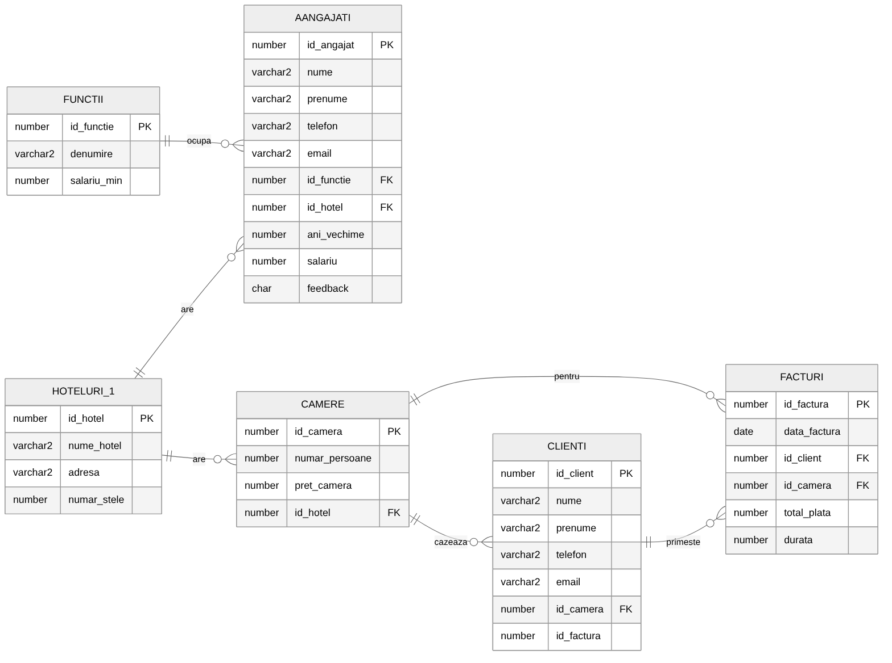

# Hotel chain database (Oracle SQL)

I built this database in my second year at ASE, for the Databases course. It keeps track of a small chain of hotels in Romania: the hotels, their staff and job titles, the rooms, the guests and their invoices. I wrote the SQL to create it, fill it with data and then query it, all in Oracle.

The full documentation (in Romanian) is in [docs/documentatie_proiect.pdf](docs/documentatie_proiect.pdf). All the data is made up.

## Schema

There are six tables. Each hotel has rooms and employees, each employee has one job title with a minimum salary, a guest stays in a room, and an invoice links the guest to that room. Besides the primary and foreign keys, I added a few constraints that keep the data correct: hotel names are unique, the star rating is between 1 and 5, salaries are positive and the employee feedback can only be P or N.

## Queries

The queries start with simple updates and deletes and go up to hierarchical queries. They cover all types of joins, group functions with GROUP BY and HAVING, UNION, INTERSECT and MINUS, DECODE and CASE, nested and correlated subqueries, and single-row functions on text and dates. For the hierarchy I added a manager column to the employees table and used CONNECT BY to show who reports to whom in each hotel. The project also creates a view, a synonym, an index and a sequence, and recovers a dropped table with FLASHBACK.

## Running it

Run the three scripts in this order, in Oracle SQL Developer or Oracle Live SQL: schema.sql, data.sql, queries.sql.

Ioana Galoș, Faculty of Cybernetics, Statistics and Economic Informatics, Bucharest University of Economic Studies (ASE)
